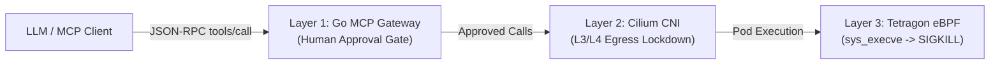

# 25-Minute Talk & Demo Guide: MCP Tool Call Enforcement with Tetragon & Cilium

> [!TIP]
> **Pacing Strategy for a 25-Minute Slot:** Aim for **19 minutes of presentation + live demo** and **6 minutes of dedicated Q&A**. Because attendees are listening, keep the live demo visual and story-driven rather than typing long commands—use the repository's `Makefile` targets or pre-staged terminal splits, and share the Killercoda link at the end so attendees stay focused on you instead of troubleshooting their own terminals mid-talk.

---

## 1. Time Allocation Overview

| Segment | Duration | Clock | Goal |
| :--- | :--- | :--- | :--- |
| **1. The Hook & Threat Model** | 4 min | `00:00 – 04:00` | Why prompt guardrails fail against indirect prompt injection & MCP `tools/call`. |
| **2. 3-Layer Defense Architecture** | 3 min | `04:00 – 07:00` | Introduce the Swiss-cheese model outside the LLM: Intent (Go), Network (Cilium), Kernel (Tetragon). |
| **3. Live Demo (All 3 Layers)** | 9 min | `07:00 – 16:00` | Walk through baseline risk, then lock down Layer 1, Layer 2, and Layer 3 live. |
| **4. Production Rollout & Takeaways** | 3 min | `16:00 – 19:00` | Audit-first eBPF rollout, dynamic risk scoring, and share the interactive Killercoda lab. |
| **5. Audience Q&A** | 6 min | `19:00 – 25:00` | Answer architectural and operational questions while the QR code / repo link stays on screen. |

---

## 2. Recommended Slide Outline (10 Slides)

### Slide 1 — Title & Hook (`00:00 – 01:00`)
* **Title:** Enforcing MCP Tool Call Safety Outside the Model with Cilium & Tetragon
* **Subtitle:** Defense-in-Depth for AI Agents on Kubernetes — MCP Dev Summit
* **Talking Points:**
  * MCP makes it trivial to give LLMs hands and feet (`tools/call`).
  * Today we'll look at what happens when an agent is tricked into calling a valid tool with malicious intent—and how we stop it at the protocol, network, and Linux kernel layers.

### Slide 2 — The Problem: Prompt Guardrails Inspect Text, Not Execution (`01:00 – 02:30`)
* **Visual:** Poisoned context (e.g., hidden instruction in a ticket/webpage) $\rightarrow$ LLM $\rightarrow$ Valid JSON-RPC 2.0 `tools/call`.
* **Talking Points:**
  * Once an LLM's context is poisoned via indirect prompt injection, it emits a **syntactically valid** MCP `tools/call` payload.
  * To the MCP server, `{"method": "tools/call", "params": {"name": "drop_database"}}` looks completely legitimate.
  * Text-based guardrails inside the model loop are probabilistic; enforcement must be **deterministic and outside the model**.

### Slide 3 — What Can Go Wrong Inside an MCP Tool Runner? (`02:30 – 04:00`)
* **Visual:** Three attack vectors mapped to failure modes:
  1. **Unauthorized High-Risk Action:** Model invokes destructive tools (`drop_database`, `modify_infra`).
  2. **Data Exfiltration:** Compromised or tricked tool runner reads internal secrets/data and `curl`s them to an external server.
  3. **Command Injection / Shell Escape:** Vulnerable tool implementation spawns `/bin/sh` or a reverse shell inside the container.

### Slide 4 — Architecture: 3-Layer Defense-in-Depth (`04:00 – 05:30`)
* **Visual:**



* **References:** [README.md](file:///home/ogembo/mcp-dev-summit/README.md#L5-L17)
* **Talking Points:**
  * **Layer 1 (Application):** Go proxy inspects `params.name` and holds high-risk or unknown tools in `PENDING_APPROVAL`.
  * **Layer 2 (Network):** Cilium enforces identity-aware L3/L4 egress so the runner can only talk to `kube-dns` and `approved-backend:8080`.
  * **Layer 3 (Kernel):** Tetragon hooks `sys_execve` in the Linux kernel via eBPF and immediately sends `SIGKILL` (`exit 137`) if a shell binary is spawned.

### Slide 5 — Deep Dive: Layer 1 (Go Approval Gateway) (`05:30 – 06:15`)
* **Visual:** Snippet from [main.go](file:///home/ogembo/mcp-dev-summit/mcp-enforcement/assets/gateway/main.go#L123-L135) showing the tri-state switch (`isLowRisk`, `isHighRisk`, and fail-safe default).
* **Talking Points:**
  * Low-risk reads (`list_inventory`, `get_status`) pass right through with zero friction.
  * High-risk tools (`drop_database`, `modify_infra`, `exec_shell`)—and **any unknown tool**—pause the HTTP request on a Go channel (`pc.decision`) until an operator hits `/approve` or `/reject`.

### Slide 6 — Deep Dive: Layers 2 & 3 (Cilium + Tetragon eBPF) (`06:15 – 07:00`)
* **Visual:** Side-by-side YAML highlights of [cnp-mcp-egress.yaml](file:///home/ogembo/mcp-dev-summit/mcp-enforcement/assets/policies/cnp-mcp-egress.yaml#L6-L31) and [tp-block-shell.yaml](file:///home/ogembo/mcp-dev-summit/mcp-enforcement/assets/policies/tp-block-shell.yaml#L6-L26).
* **Talking Points:**
  * Why eBPF? Because the container itself cannot bypass policies enforced in the Linux kernel datapath.
  * Even if a tool call is approved at Layer 1, Cilium stops it from phoning home, and Tetragon kills any shell process before `/bin/sh` finishes initializing.

### Slide 7 — Transition to Live Demo (`07:00 – 16:00`)
* **Title:** Live Demo: Breaking & Hardening `mcp-demo`
* **On-Screen Graphic:** Keep a minimal legend of the 3 pods in namespace `mcp-demo`: `mcp-gateway`, `mcp-tool-runner`, and `approved-backend` ([k8s.yaml](file:///home/ogembo/mcp-dev-summit/mcp-enforcement/assets/gateway/k8s.yaml)).

### Slide 8 — Productionizing: From Lab to Real Clusters (`16:00 – 17:30`)
* **References:** [finish.md](file:///home/ogembo/mcp-dev-summit/mcp-enforcement/finish.md#L9-L15)
* **Talking Points:**
  * **Don't start with `Sigkill` on Day 1:** Start Tetragon policies in observability/audit mode (`Post` action) to baseline normal tool-runner processes, then switch to `Sigkill` or `Override`.
  * **Harden binary matching:** In production, pair path/postfix selectors with binary hashes or immutable distroless images so attackers can't simply copy `/bin/sh` to `/tmp/runner`.
  * **Dynamic Gateway Policy:** Evolve static tool-name lists into argument-aware policy (e.g., OPA/Cedar or Slack/PagerDuty approval webhooks).

### Slide 9 — Try It Yourself (Interactive Lab + Repo) (`17:30 – 19:00`)
* **Visual:** Large QR code + URL to the GitHub repo (`https://github.com/ZEZE1020/mcp-tetragon-enforcement`) and Killercoda scenario ([index.json](file:///home/ogembo/mcp-dev-summit/mcp-enforcement/index.json)).
* **Talking Points:**
  * Everything you just saw is packaged both as a self-paced Killercoda browser lab and a local `Makefile` + Kind setup.
  * Point out why you saved the link for the end: so everyone could watch the kernel enforcement live first, and now run it themselves at their own pace.

### Slide 10 — Q&A (`19:00 – 25:00`)
* **Visual:** Keep the Architecture diagram (from Slide 4) and the Repo QR code visible during the entire 6-minute Q&A.

---

## 3. Choreographed 9-Minute Live Demo Walkthrough (`07:00 – 16:00`)

> [!IMPORTANT]
> **Pre-Demo Terminal Setup:**
> Use a **2-pane horizontal tmux or terminal split** with large font (`18pt+`):
> * **Top Pane (Action Pane):** Where you run `curl`, `kubectl`, and `make` commands.
> * **Bottom Pane (Watch/Approval Pane):** For inspecting `/pending`, approving requests, and tailing Tetragon `tetra getevents`.

### Pre-Flight (Before Your Talk Starts)
Ensure the cluster and workloads are up, and policies are **reset** so your baseline attacks initially succeed:
```bash
make up
make reset
kubectl apply -f mcp-enforcement/assets/gateway/k8s.yaml
kubectl get pods -n mcp-demo
```

---

### Act 1: Layer 1 — Application Approval Gate (`07:00 – 10:00` | 3 mins)

1. **Show the running pods (`30s`):**
   ```bash
   kubectl get pods -n mcp-demo
   ```
   *Say:* "We have our three workloads running: `mcp-gateway`, `mcp-tool-runner`, and `approved-backend`."

2. **Send a low-risk tool call (`45s`):** ([step1.md](file:///home/ogembo/mcp-dev-summit/mcp-enforcement/step1.md#L48-L51))
   ```bash
   curl -sS -X POST http://localhost:30090/mcp \
     -H 'Content-Type: application/json' \
     -d '{"jsonrpc":"2.0","id":1,"method":"tools/call","params":{"name":"list_inventory","arguments":{"scope":"demo"}}}'
   ```
   *Say:* "When the agent calls a read-only tool like `list_inventory`, the gateway forwards it immediately."

3. **Trigger a high-risk tool call via prompt injection (`1m 45s`):** ([step1.md](file:///home/ogembo/mcp-dev-summit/mcp-enforcement/step1.md#L60-L85))
   *In Top Pane (hangs waiting for approval):*
   ```bash
   curl -sS -X POST http://localhost:30090/mcp \
     -H 'Content-Type: application/json' \
     -d '{"jsonrpc":"2.0","id":2,"method":"tools/call","params":{"name":"drop_database","arguments":{"target":"prod"}}}'
   ```
   *Say:* "Now the LLM hits a poisoned prompt and calls `drop_database`. Notice my terminal is hanging! The gateway caught the high-risk tool and paused execution."

   *In Bottom Pane (inspect & approve):*
   ```bash
   curl -sS http://localhost:30090/pending
   curl -sS -X POST "http://localhost:30090/approve?id=1"
   ```
   *Say:* "In our bottom pane, we inspect `/pending`, see `PENDING_APPROVAL`, and explicitly approve `id=1`. The moment we approve, look at the top pane—the request unblocks and completes."
   *(Fallback if short on time: run `make demo-gateway` which runs [trigger-high-risk.sh](file:///home/ogembo/mcp-dev-summit/mcp-enforcement/assets/scripts/trigger-high-risk.sh) end-to-end).*

---

### Act 2: Layer 2 — Cilium Egress Lockdown (`10:00 – 13:00` | 3 mins)

1. **Demonstrate the baseline exfiltration risk (`45s`):** ([step2.md](file:///home/ogembo/mcp-dev-summit/mcp-enforcement/step2.md#L10-L11))
   ```bash
   kubectl -n mcp-demo exec deploy/mcp-tool-runner -- sh -c 'curl -sSI --max-time 5 https://example.com | head -n 1'
   ```
   *Say:* "What if an approved tool is compromised and tries to exfiltrate data to the internet? Right now, `HTTP/2 200`—it can reach `example.com`."

2. **Apply the Cilium Network Policy (`45s`):** ([cnp-mcp-egress.yaml](file:///home/ogembo/mcp-dev-summit/mcp-enforcement/assets/policies/cnp-mcp-egress.yaml))
   ```bash
   kubectl apply -f mcp-enforcement/assets/policies/cnp-mcp-egress.yaml
   ```
   *Say:* "Let's apply our `CiliumNetworkPolicy`. It restricts `mcp-tool-runner` egress strictly to `kube-dns` on port 53 and `approved-backend` on port 8080."

3. **Verify blocked exfiltration vs. allowed internal traffic (`1m 30s`):** ([test-exfiltration.sh](file:///home/ogembo/mcp-dev-summit/mcp-enforcement/assets/scripts/test-exfiltration.sh))
   ```bash
   ./mcp-enforcement/assets/scripts/test-exfiltration.sh
   ```
   *Say:* "We run our exfiltration check: talking to `approved-backend` returns `HTTP 200`, while `example.com` times out with exit code 28. The eBPF datapath dropped the packets."

---

### Act 3: Layer 3 — Tetragon Kernel Syscall Enforcement (`13:00 – 16:00` | 3 mins)

1. **Show baseline shell execution inside the container (`45s`):** ([step3.md](file:///home/ogembo/mcp-dev-summit/mcp-enforcement/step3.md#L10-L11))
   ```bash
   kubectl exec -n mcp-demo deploy/mcp-tool-runner -- /bin/sh -c "id"
   ```
   *Say:* "Finally, what if a tool has a command injection bug and spawns a shell? Right now, `/bin/sh -c id` works and prints `uid`."

2. **Apply Tetragon `TracingPolicyNamespaced` (`45s`):** ([tp-block-shell.yaml](file:///home/ogembo/mcp-dev-summit/mcp-enforcement/assets/policies/tp-block-shell.yaml))
   ```bash
   kubectl apply -f mcp-enforcement/assets/policies/tp-block-shell.yaml
   ```
   *Say:* "We apply our Tetragon policy hooking the Linux kernel `sys_execve` syscall for `/sh`, `/bash`, `/dash`, and `/zsh` with `action: Sigkill`."

3. **Trigger the shell escape and show `Exit Code 137` + Kernel Telemetry (`1m 30s`):** ([test-shell-escape.sh](file:///home/ogembo/mcp-dev-summit/mcp-enforcement/assets/scripts/test-shell-escape.sh))
   ```bash
   ./mcp-enforcement/assets/scripts/test-shell-escape.sh
   ```
   *Say:* "Look at that: `command terminated with exit code 137` (`128 + 9`, `SIGKILL`). The kernel killed the shell before it could even run `id`. And right below it, Tetragon's `tetra getevents` stream shows the exact pod, binary, and `SIGKILL` action."

---

## 4. Speaker Q&A Prep (Likely Audience Questions)

1. **"Why not just use a distroless container image with no shell instead of Tetragon?"**
   * *Answer:* Distroless is great hygiene and you should use it! However, many Python/Node MCP tool servers pull in OS packages or interpreters, or an attacker may drop a statically linked binary into memory/tmpfs. Tetragon enforces at the kernel syscall boundary regardless of image contents, and gives real-time forensic telemetry (`tetra getevents`) when an attempt happens.
2. **"Does holding HTTP requests open in the Go Gateway scale for long human approvals?"**
   * *Answer:* In this demo ([main.go](file:///home/ogembo/mcp-dev-summit/mcp-enforcement/assets/gateway/main.go#L158-L180)), we block on a Go channel (`pc.decision`) for simplicity so standard synchronous MCP clients work without code changes. For multi-minute approvals in production, you can either return an async status token to the agent or configure client timeouts alongside webhook notifications.
3. **"What if an attacker renames `/bin/sh` to `/tmp/mytool` to bypass the `Postfix` match?"**
   * *Answer:* Great catch! In [tp-block-shell.yaml](file:///home/ogembo/mcp-dev-summit/mcp-enforcement/assets/policies/tp-block-shell.yaml#L19-L24) we match path postfixes for clarity, but in production you combine Tetragon process ancestry rules (e.g., blocking `execve` from the MCP server binary entirely if it shouldn't spawn child processes) with read-only root filesystems (`readOnlyRootFilesystem: true`).
